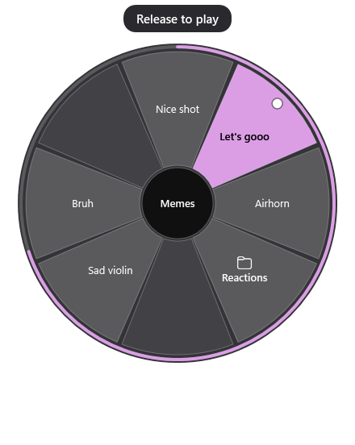
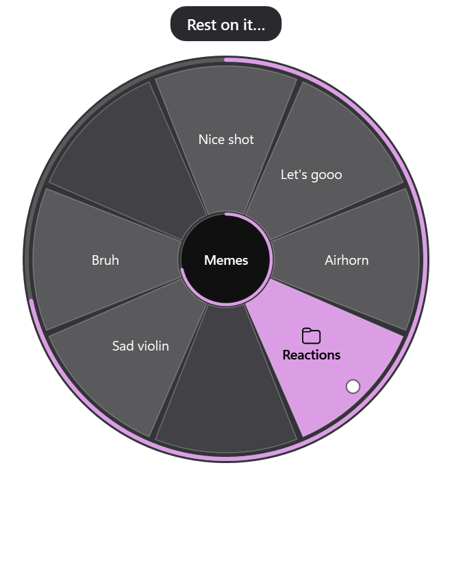
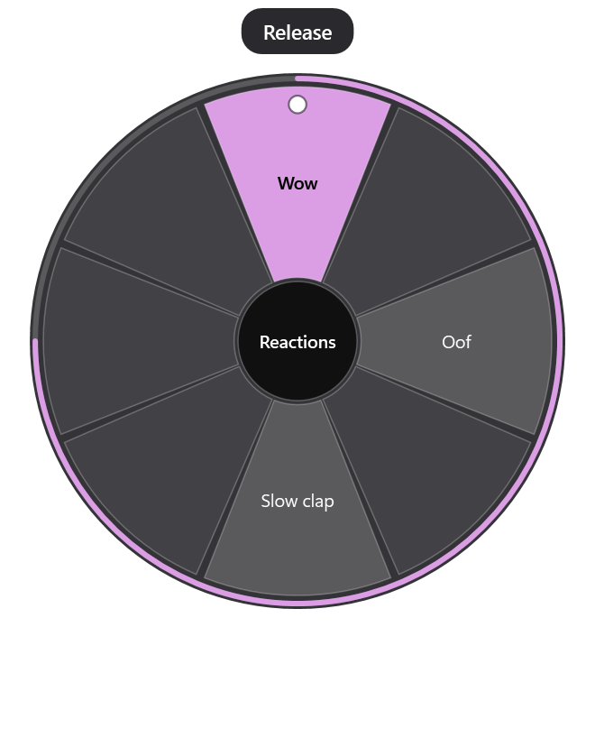
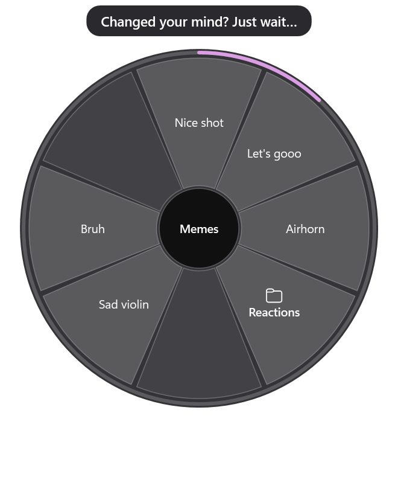
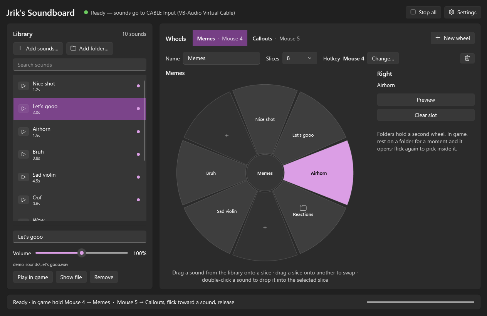

<div align="center">



# Jrik's Soundboard

### The soundboard you play with a flick.

Hold one key, flick your mouse toward a sound, release — it plays through your mic in game.<br>
No list of hotkeys to memorize. Just muscle memory.

**Windows** · tested in **Counter-Strike 2** · no injection, no game hooks

**[Download for Windows](https://github.com/jriiik/jriks-soundboard/releases/latest)**

</div>

---

## Why a wheel?

Most soundboards bind every sound to its own hotkey. That's fine for five sounds — at fifty you're memorizing key combos instead of playing.

Jrik's Soundboard puts your sounds on a **radial wheel**:

- **One key, many sounds.** Each wheel holds 4–16 sounds, picked by the *direction* you flick.
- **Folders inside the wheel.** Any slice can open a second wheel — up to **256 sounds on a single key**.
- **Muscle memory instead of memorization.** Sounds never move, so after a few games your hand just knows that *Airhorn* is "flick right".
- **Works while the game locks your cursor.** The wheel reads raw mouse movement like a joystick, so it works mid-match.
- **As many wheels as you want**, each on its own key — mouse side buttons are perfect.

## How it works

| 1 · Hold | 2 · Flick | 3 · Release |
|:---:|:---:|:---:|
| Hold your wheel key — the wheel pops up over the game. | Flick toward a sound. A small flick is enough. | The sound plays through your mic. A timer shows how long it lasts, so you know how long to hold push-to-talk. |

### Folders — a wheel inside the wheel

<table>
<tr>
<td align="center" width="50%"></td>
<td align="center" width="50%"></td>
</tr>
<tr>
<td align="center"><b>Rest on a folder for a moment…</b></td>
<td align="center"><b>…it opens. Flick again to pick inside.</b></td>
</tr>
</table>

Group your sounds however you like — *Reactions*, *Callouts*, *Music*… A folder opens in about a third of a second, and the whole path becomes a reflex: "down-right, then up" is just *Wow*.

### Changed your mind?

<table>
<tr>
<td width="260"></td>
<td>Release in the centre to cancel — or just keep holding. The ring around the wheel shows the time left; when it runs out, the wheel cancels itself and plays a soft cue that <b>only you</b> hear, so you never have to look. Three seconds by default, adjustable, or off.</td>
</tr>
</table>

### Build your wheels by drag & drop



Drop audio files or whole folders into the library, then drag sounds onto slices. Drag one slice onto another to swap them, turn any slice into a folder, or change the number of slices — sounds keep pointing in the same direction, so your muscle memory survives.

## Also in the box

- **Overlay on top of the game** (windowed / fullscreen-windowed) or **over the app window** on your second monitor.
- **Microphone modes:** use the game's own push-to-talk (default), push-to-talk handled by the app, voice activation, or mic off.
- **Preview in your headphones only**, per-sound volume, and optional **loudness levelling** so every clip sounds about equally loud.
- **mp3, wav, ogg, flac, m4a, wma** — decoded into memory, so sounds start instantly.
- Everything else lives behind one **Settings** button, so the main window stays clean.

## Anti-cheat safety

The game should only ever see "one more microphone". The app never:

- injects DLLs, reads or writes game memory, or hooks game rendering;
- sends simulated key presses or mouse input to the game;
- installs a driver of its own (VB-Cable is a separate, signed audio driver).

Hotkeys are observed with Windows **Raw Input** (`RIDEV_INPUTSINK`), which is read-only: it cannot block or change what the game receives. The overlay is a separate see-through window that never takes focus — it is not drawn inside the game.

> **Disclaimer:** This project is not affiliated with or endorsed by Valve. It is designed not to interact with any game, but no one can guarantee how an anti-cheat behaves — use it at your own risk. Also remember that other players can report voice-chat spam.

## Getting started

You need Windows 10 or 11 (64-bit) and [VB-Audio Virtual Cable](https://vb-audio.com/Cable/) — free, a separate product with its own license, not included here. Reboot after installing it.

**Option 1 — download (easiest):** grab **JriksSoundboard.exe** from the [latest release](https://github.com/jriiik/jriks-soundboard/releases/latest) and run it. It's a single file: no installer, no .NET install needed. Windows may warn that the app isn't signed yet — click **More info → Run anyway**.

**Option 2 — build from source** (needs the [.NET 10 SDK](https://dotnet.microsoft.com/download)):

```bash
git clone https://github.com/jriiik/jriks-soundboard.git
cd jriks-soundboard
dotnet run --project src/JriksSoundboard.App
```

Then set it up:

1. **Steam → Settings → Voice → Voice Input Device:** choose *CABLE Output (VB-Audio Virtual Cable)* and turn *Voice Transmission Threshold* off.
2. In the app, click **Add sounds…** (or drag files in) and drag them onto the wheel's slices.
3. In CS2, hold your push-to-talk key, hold the wheel key (default **Mouse 4**), flick toward a sound and release. Keep holding push-to-talk until the sound ends.
4. To hear yourself while testing: open a private match and run `voice_loopback 1` in the console.

## Development

```bash
dotnet test
```

The tests cover the wheel logic (directions, folders, auto-cancel), the library model, the sound cache and settings, plus a hardware check that plays a tone into *CABLE Input* and verifies it arrives on *CABLE Output* (skipped when VB-Cable isn't installed).

`JriksSoundboard.exe --snapshot <folder>` renders every screen with demo data — plus the animation frames used in this README — to PNG files and exits. It uses its own data folder inside `<folder>`.

| Path | What |
|---|---|
| `src/JriksSoundboard.Core/Wheel` | Wheel logic: flick direction, folders, auto-cancel |
| `src/JriksSoundboard.Core/Audio` | Audio engine (NAudio / WASAPI): mixing, mic gate, decoding, sound cache |
| `src/JriksSoundboard.Core/Input` | Passive Raw Input listener, key names |
| `src/JriksSoundboard.Core/Board` | Library + wheels model and storage (`board.json`) |
| `src/JriksSoundboard.Core/Runtime` | Wires hotkeys, wheels, cache and audio together |
| `src/JriksSoundboard.Core/Settings` | Settings (`settings.json`) |
| `src/JriksSoundboard.App` | WPF app: main window, wheel editor, overlay, settings |
| `tests/JriksSoundboard.Core.Tests` | xUnit tests |

User data lives in `%APPDATA%\JriksSoundboard`.

## License

[MIT](LICENSE)
